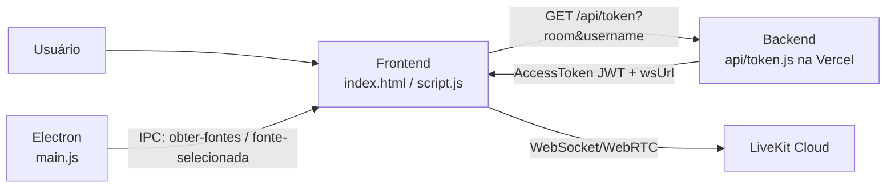

# AppTransmitir

Aplicativo para **transmissão de tela em tempo real** em salas colaborativas, utilizando [LiveKit](https://livekit.io/) (WebRTC/SFU). O projeto pode ser executado como aplicação desktop com Electron ou diretamente no navegador.

O problema que o projeto resolve é permitir que um participante compartilhe sua tela com outros usuários conectados à mesma sala, com seleção de qualidade, áudio e indicação de status "ao vivo" para cada participante.

## Links de acesso

- **Aplicação web (Vercel):** https://app-transmissao.vercel.app
- **Repositório:** https://github.com/Matheus-Perpetuo/app-transmissao

## Funcionalidades implementadas

- Entrada em sala com apelido e nome de sala.
- Restrição da sala ao identificador `summit`.
- Conexão a uma sala LiveKit com token gerado pelo backend.
- Exibição do vídeo/áudio remoto recebido.
- Lista de participantes com contagem de usuários.
- Indicador "AO VIVO" para participantes que estão transmitindo tela.
- Início e parada de transmissão de tela.
- Seleção de qualidade de transmissão:
  - 720p - 30 FPS
  - 1080p - 30 FPS
  - 1080p - 60 FPS
- Captura de áudio junto com a tela.
- Modo desktop (Electron) com seletor personalizado de tela/janela.
- Modo navegador com seletor nativo de captura.
- Persistência local do apelido no `localStorage`.
- Cópia do nome da sala para a área de transferência.
- Exibição da versão do app no Electron e identificação "Web" no navegador.

## Tecnologias utilizadas

| Tecnologia | Papel no projeto |
|---|---|
| HTML, CSS e JavaScript | Interface e lógica do frontend |
| Electron | Aplicação desktop, captura de tela/janela e IPC |
| LiveKit Client SDK | Conexão à sala, publicação e assinatura de tracks |
| Node.js | Runtime do servidor local e das funções serverless |
| LiveKit Server SDK | Geração de tokens de acesso no backend |
| Vercel | Hospedagem estática e execução das funções em `api/` |

## Arquitetura e funcionamento

A aplicação é dividida em três partes principais: frontend, backend serverless e serviço externo LiveKit Cloud.



Fluxo de entrada em uma sala:

1. O usuário informa apelido e nome da sala.
2. O frontend valida os campos e verifica se a sala é `summit`.
3. O frontend chama `/api/token` com `room` e `username`.
4. O backend valida os parâmetros, gera um `AccessToken` com permissão de entrar, publicar e assinar tracks, e retorna o token JWT e a URL WebSocket.
5. O frontend cria uma instância `LivekitClient.Room` e conecta-se ao LiveKit Cloud.
6. Eventos de track e participantes atualizam a interface.

Fluxo de transmissão:

1. No Electron, o botão de transmissão abre uma janela seletora (`seletor.html`) que lista telas e janelas via `desktopCapturer`.
2. A fonte selecionada é enviada ao processo principal por IPC.
3. O processo principal configura `setDisplayMediaRequestHandler` para capturar exatamente a fonte escolhida e áudio loopback.
4. No navegador, a captura usa `navigator.mediaDevices.getDisplayMedia` diretamente.
5. A track de vídeo é publicada com codec H264, sem simulcast e com bitrate máximo conforme a qualidade escolhida.
6. A track de áudio, quando disponível, também é publicada.
7. Ao parar, as tracks são despublicadas e interrompidas, e a interface é restaurada.

## Estrutura de pastas

```text
app-transmissao/
├── api/
│   ├── auth.js          # Endpoint de autenticação por código de acesso
│   └── token.js         # Geração de token LiveKit
├── dev-server.js        # Servidor local de desenvolvimento
├── index.html           # Interface principal
├── main.js              # Processo principal do Electron
├── script.js            # Lógica do frontend e da transmissão
├── seletor.html         # Seletor de fonte de captura (Electron)
├── seletor.js           # Lógica do seletor de fonte
├── style.css            # Estilos da interface
├── vercel.json          # Configuração de deploy na Vercel
├── .env.example         # Exemplo de variáveis de ambiente
└── package.json
```

## Decisões técnicas

- **Sala única (`summit`):** o frontend e o backend restringem a sala permitida a `summit`, simplificando a colaboração e evitando criação arbitrária de salas.
- **Base da API dinâmica:** `obterBaseApi()` retorna caminho relativo quando a página é servida por HTTP/HTTPS (web/Vercel) e a URL da Vercel quando executada via `file://` (Electron).
- **Captura exata no Electron:** o seletor personalizado permite escolher tela ou janela específica; o processo principal revalida a fonte selecionada antes de capturar.
- **Configuração de mídia:** `adaptiveStream` e `dynacast` são desativados, e a publicação usa H264 sem simulcast para priorizar estabilidade da transmissão de tela.
- **Perfis de qualidade:** cada opção define resolução, frame rate e bitrate máximo aplicados na captura e na publicação.
- **Estado no frontend:** o estado é gerenciado com variáveis globais e eventos do LiveKit, sem framework de estado, adequado ao escopo do projeto.
- **Persistência local:** o apelido é salvo no `localStorage` para reutilização entre sessões.

## Configuração e instalação

### Pré-requisitos

- Node.js instalado
- Conta no [LiveKit Cloud](https://livekit.io/) com projeto e chaves de API

### Clonagem e instalação

```bash
git clone https://github.com/Matheus-Perpetuo/app-transmissao.git
cd app-transmissao
npm install
```

### Variáveis de ambiente

Copie o arquivo de exemplo e preencha com as credenciais do LiveKit Cloud:

```bash
cp .env.example .env
```

```env
LIVEKIT_API_KEY=sua-api-key
LIVEKIT_API_SECRET=seu-api-secret
LIVEKIT_URL=wss://seu-projeto.livekit.cloud
```

Na Vercel, configure as mesmas variáveis em **Settings > Environment Variables**.

### Execução local

Modo navegador:

```bash
npm run dev
```

Acesse `http://localhost:3000`.

Modo desktop (Electron):

```bash
npm start
```

### Build do desktop

```bash
npm run build
```

O instalador é gerado na pasta `dist/`.

## Segurança

- Chaves e segredos são lidos exclusivamente de variáveis de ambiente.
- O arquivo `.env` está no `.gitignore` e não é versionado.
- O endpoint `/api/token` exige os parâmetros `room` e `username` e aceita apenas a sala `summit`.
- O endpoint `/api/auth` existe para validação por código de acesso, mas o frontend atual não o utiliza.
- O backend usa CORS com origem `*`, permitindo acesso de qualquer origem ao endpoint de token.
- A aplicação Electron utiliza `nodeIntegration: true` e `contextIsolation: false`, o que aumenta a superfície de ataque caso conteúdo não confiável seja carregado; o app carrega apenas arquivos locais.
